## h2 Voileipä ##

#### x) Lue ja tiivistä ####

**Sudo without password**

Artikkelissa kerrotaan, miten luodaan uusi käyttäjä ja lisätään se ryhmään, jolle annetaan oikeus käyttää sudo-komentoa ilman salasanaa.
Ryhmälle annetaan kyseinen oikeus lisäämällä sääntö /etc/sudoers.d/-kansioon. (Karvinen 2026)

**xkcd 149: Sandwitch**

- sudo-komennolla tavallinen käyttäjä voi ajaa komentoja admin-oikeuksilla. (Munroe 2006)

**Passwordless Sudo with Ansible**

Artikkelissa kerrotaan, miten Ansiblessa tehdään rooli, joka tekee uuden käyttäjän, lisää sen sudoless-ryhmään (jolle on aiemmin annettu oikeus käyttää sudo-komentoa ilman salasanaa) ja lisää /etc/sudoers.d/-hakemistoon säännön kyseisestä oikeudesta. (Karvinen 2026)

**Ansiblen sisäänrakennettu dokumentaatio**

Ansiblen omasta dokumentaatiosta poimittu annetut moduulit ja optiot. (Ansibke, s.a.)

*'ansible-doc copy'*: content, dest, src; owner, group, mode;

- kopioi tiedoston tai kansiorakenteen paikalliselta tai etäkoneelta jonnekin etäkoneella olevaan määriteltyyn sijaintiin. Kopioitavalle datalle voidaan määritellä meta-tiedot (esim. luvat ja omistajuus), vaikka data olisi jo olemasa kohdejärjestelmässä.
- *content:* asettaa tiedoston sisällöksi annetun arvon, luo tiedoston uutena jos ei ole jo olemassa
- *dest:* relatiivinen absoluuttinen polku, jonne tiedosto kopioidaan. Jos sekä dest että src ovat tiedostoja, kohdekansio pitää olla olemassa.
- *group:* kohteen omistava ryhmä, syötetään kuten komennolle chown. Ilman attribuuttia ottaa käyttäjän ryhmän, rootilla säilyttää edellisen omistajan.
- *mode:* kohdekansion tai -tiedoston luvat. Voidaan asettaa oktaalinumeroilla tai merkeillä, 'preserve' säilyttää alkuperäiset. Poisjättäminen asettaa oletusarvot uudelle tiedostolle tai kopioi olemassaolevan arvot.
- *owner:* kohteen omistavat käyttäjä. Ilman määrittelyä käytetään nykyistä käyttäjää, paitsi rootille ottaa aiemman omistajan.
- *src:* paikallinen polku joka kopioidaan etäpalvelimelle. Voi olla absoluuttinen tai suhteellinen. Jos polku loppuu '/', vain sen kansion sisältö kopioidaan, muuten kopioidaan koko polku sisältöineen.
- *esimerkki:* Kopioi tiedoston omistajalla ja luvilla (asetettu oktaalinumeroilla)

    ansible.builtin.copy:
    src: /srv/myfiles/foo.conf
    dest: /etc/foo.conf
    owner: foo
    group: foo
    mode: '0644'

*'ansible-doc apt'*: name, state, update_cache;
- hallinnoi apt-paketteja.
- *name:* listaa paketin nimen, ottaa vastaan myös versionumeron tai katkaistun haun *-merkillä.
- *state:* tarkentaa halutun paketin tilan, esim. 'latest' asentaa viimeisimmän version.
- *update_cache:* vastaa apt-get update-komennon ajamista. Voidaan suorittaa osana pakettien asennusta tai erillisenä vaiheena. Oletuksena ei ajeta.
- *esimerkki:* asentaa listan paketteja

    ansible.builtin.apt:
    pkg:
    - foo
    - foo-tools

*'ansible-doc file'*: path, recurse, src, state. owner, group, mode;
- asettaa tiedostoje, kansioiden, symbolisten linkkien ja niiden kohteiden attribuutteja.
- *group, mode, owner:* ks. ansible-doc copy edellä. vastaava logiikka.
- *path:* polku käsiteltävään tiedostoon.
- *recurse:* asettaa tiedoston attribuutit rekursiivisesti kansion sisältöön. Toimii vain jos state = directory
- *src:* polku linkitettävään tiedostoon.
- *state:* poistaa rekursiivisesti, luo, muokkaa, linkittää tiedostoja tai kansioita.
- *esimerkki:* muuttaa tiedoston omistajaa, ryhmää ja lupia

    ansible.builtin.file:
    path: /etc/foo.conf
    owner: foo
    group: foo
    mode: '0644'

*'ansible-doc user'*: name; create_home, comment, groups, shell, state, system.
- hallinnoi käyttäjätilejä ja käyttäjien attribuutteja.
- *comment:* asettaa käyttäjätilin kuvauksen.
- *create_home:* luo oletuksena kotikansion uudelle käyttäjälle ellei sellaista jo ole.
- *groups:* asettaa käyttäjän ensisijaisen ryhmän.
- *name:* luotavan, poistettavan tai muokattavan käyttäjän nimi.
- *shell:* asettaa käyttäjän shellin.
- *state:* asettaa käyttäjän tilan (olemassa tai ei), tekee toimenpiteitä jos tila on eri kuin ilmoitettu.
- *esimerkki:* lisää käyttäjän tietyllä UID-tunnuksella admin-ryhmään

    ansible.builtin.user:
    name: johnd
    comment: John Doe
    uid: 1040
    group: admin

*'ansible-doc authorized_key'*: user, key.
- lisää tai poistaa SSH-avaimia yhdelle tai useammalle tietylle käyttäjätilille.
- *key:* julkinen SSH-avain.
- *user:* etäpalvelimella olevan käyttäjän nimi, jonka authorized_keys-tiedostoa muokataan.
- *esimerkki:* aseta SSH-avaimet, tiedostopolku isäntäkoneella

    ansible.posix.authorized_key:
    user: charlie
    state: present
    key: file:///home/charlie/.ssh/id_rsa.pub

#### a) Sudoless ####

Kirjauduin etäpalvelimelleni ja loin tehtävää varten uuden käyttäjän, ryhmän ja lisäsin käyttäjän siihen. Käytetyt komennot:

    sudo adduser [käyttäjä]
    sudo groupadd [ryhmä]
    sudo adduser käyttäjä ryhmä

Tässä vaiheessa avasin varmuuden vuoksi toisen terminaalin rootina, jos jotain menee pieleen niin root-terminaalista pääsee korjaamaan. Root-käyttäjän tunnistaa siitä, että terminaalissa näkyy ~# eikä ~#.

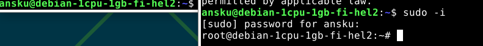

Sääntö siitä, että sudoless-ryhmään kuuluvat käyttäjät voivat käyttää sudo-komentoa ilman salasanaa lisätään luomalla tiedosto kansioon /etc/sudoers.d/sudoless. Komento:

    sudo visudo /etc/sudoers.d/sudoless

luo ja avaa tiedoston oletuseditorissa (omalla koneella se on nano). Sääntö luodaan lisäämällä kyseiseen tiedostoon

    %sudoless ALL = (ALL) NOPASSWD: ALL

Tällä annetaan sudoless-ryhmän kaikille koneille ja kaikille käyttäjille lupa ajaa kaikki komennot ilman salasanaa.

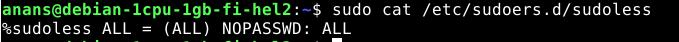

Kokeilin kirjautua, mutta en tietenkään pääse sisään koska en ole lisännyt uuden käyttäjän SSH-avainta etäpalvelimelle.

Kävin lisäämässä SSH-avaimen uudelle käyttäjälle, ajamalla seuraavat komennot:

    sudo mkdir -p /home/USER/.ssh
    sudo chmod 700 /home/USER/.ssh
    sudo nano /home/USER/.ssh/authorized_keys (kopioin tänne julkisen SSH-avaimen virtuaalikoneelta)
    sudo chmod 600 /home/USER/.ssh/authorized_keys
    sudo chown -R USER:USER /home/USER/.ssh

Tämän jälkeen kirjauduin luomallani käyttäjällä sisään anans@VPSIP ja kokeilin saman tien, toimiiko käyttäjällä sudo ilman salasanaa:

Toimiihan se. Tämä osio oli tehty Karvisen (Karvinen 2026) ohjeiden perusteella, poislukien SSH-avaimen lisäys. Sen komennot jouduin lunttaamaan Niemen raportista (Niemi 2025).

#### b) Antero ####

Loin isäntäkoneelleni ansible-kansioon uuden kansion tätä roolia varten, ja sinne main.yml-tiedoston:

    mkdir -p roles/anans/tasks/
    nano roles/anans/tasks/main.yml

    - group:
        name: "sudoless"
        state: present
    - user:
        name: "anans"
        state: present
        groups: ["sudoless", "sudo", "adm"]
    - authorized_key:
        user: "anans"
        key: "kopioin tähän oman koneeni julkisen ssh-avaimen"
    - copy:
        dest: "/etc/sudoers.d/sudoless"
        content: "%sudoless ALL = (ALL) NOPASSWD: ALL\n"
        owner: "root"
        group: "root"
        mode: "0644"

Koska olin jo aiemmin tehnyt käyttäjän anans ja ryhmän sudoless, niiden tilaksi (state) tuli laittaa 'present'.

Tämän jälkeen lisäsin tiedostoon site.yml 'become: true' seuraavasti:

    - hosts: all
      become: true
      roles:
        - world
        - antero

Ajoin komennon ansible-playbook site.yml ja kuten pitikin, ansible herjaa puuttuvasta sudo-salasanasta:

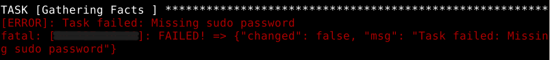

Kokeilin ensin Karvisen ohjeiden mukaista komentoa "ansible-playbook site.yml --ask-become-password", mutta se on väärä. Oikea komento on:

    ansible-playbook site.yml --ask-become-pass

Tämän komennon myötä ansible pyytää salasanaa. En ensin tajunnut, mitä salasanaa tässä haettiin. Luulin että ansible halusi jonkun olemassa olevista salasanoista. Sain virheilmoituksen väärästä sudo-salasanasta:

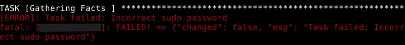

Siihen kuuluikin laittaa joku uusi salasana. Tämän jälkeen playbook meni läpi ilman ongelmia.

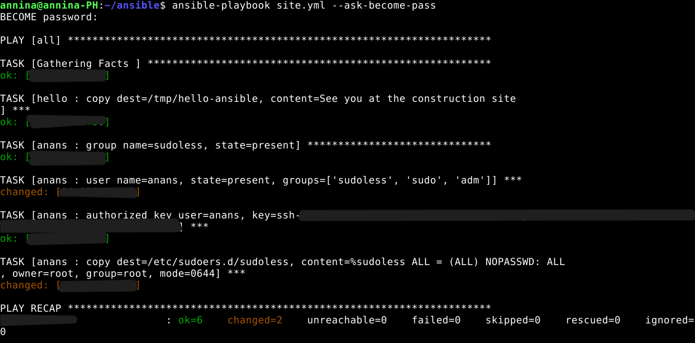

Laitoin alkuun become-salasanaksi jotain aivan liian yksinkertaista, koska halusin testata että olenko ymmärtänyt oikein ja komento haluaa täysin uuden salasanan. Playbook meni kyllä läpi ilman ongelmia, mutta en halunnut jättää turvatonta salasanaa. Ajoin uudelleen komennon ansible-playbook site.yml --ask-become-pass ja laitoin salasanaksi jotain paljon turvallisempaa.

Tämä osio tehty Karvisen ohjeilla (Karvinen 2026), paitsi kohta --ask-become-password. Se on katsottu ansiblen omasta ohjeistuksesta, joka aukesi virheellisen komennon ajamisen seurauksena.

#### c) Package ####

Tätä tehtävää varten piti asentaa kaksi pakettia, ja halusin asentaa jotkut nopeat ja helpot. Tarkistin seuraavalla komennolla etäpalvelimelta, oliko joku harkitsemistani ohjelmista jo asennettu (tiesin että tree oli, mutta halusin nähdä miten se vaikuttaa komennon tulokseen):

    apt policy tree curl btop htop

Kuvakaappauksessa näkyy, että curl on asennettu. Komento näyttää asennetun version. btopia ei ole asennettu, joten sen kohdalla näkyy 'Installed: (none)'

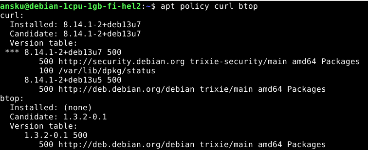

Koska vaihtoehdoistani btop ja htop on asentamatta, ajan ne. Loin ansiblen roles-kansioon uuden alikansion ja sinne main.yml-tiedoston. (Ansible Community documentation, s.a.) 

    mkdir -p roles/packages/tasks/
    nano roles/packages/tasks/main.yml

    - name: Install a list of packages
      ansible.builtin.apt:
        pkg:
        - btop
        - htop

Tämän jälkeen lisäsin uuden roolin site.yml-tiedostoon. Jos kaikki meni oikein, ansible-playbook site.yml pitäisi asentaa btop ja htop.

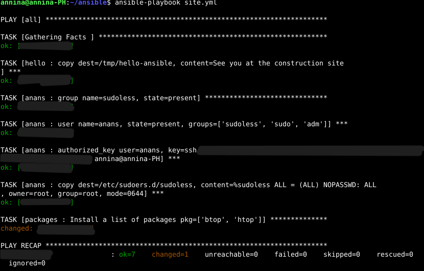

Kaikki meni kuten pitikin, RECAP näyttää failed=0. Kirjauduin vielä etäpalvelimelle ja ajoin komennon:

    apt policy htop btop

Kuvakaappauksesta näkyy, että nyt molempien kohdalla on 'installed'.

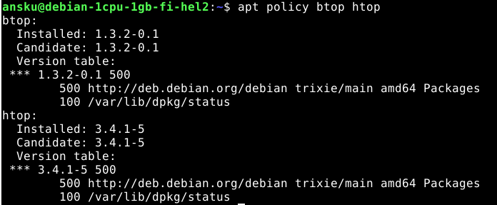

#### d) File ####

Tätä tehtävää varten piti luoda useamman rivin tiedosto ja määrittää sille omistaja, omistava ryhmä sekä oikeudet oktaalinumeroilla. Lopuksi piti vielä selittää, mitä kukin käyttäjä voi tehdä tiedostolle. 

En muistanut enää, mitä Karvisen ohjeiden vinkki 'copy: src: foo.txt -> roles/superd/files/foo.txt' tarkoitti, joten varmistin tekoälyltä (Claude Sonnet 5.5.), että teen uuteen roles-kansioon files-alikansion txt-tiedostolle, ja tasks-alikansion ansible.builtin.copy-moduulille ja sen parametreille.

Ansiblen oman dokumentaation mukaan (Ansible s.a) em. moduuli sallii parametrin, jolla lisätä sisältöä (content:), mutta se soveltuu paremmin yhden rivin sisällölle.

Aloitin luomalla kaksi uutta alikansiota, ja sen jälkeen files-alikansioon tekstitiedoston ja tasks-alikansioon main.yml-tiedoston (id.).

    mkdir -p roles/filing/files/ roles/filing/tasks/
    nano roles/filing/files/potato.txt
    nano roles/filing/tasks/main.yml

    - name: Copy file with owner and permission
      ansible.builtin.copy:
        src: potato.txt
        dest: /tmp/potato.txt
        owner: ansku
        group: adm
        mode: '0640'

src-poluksi riittää pelkkä tiedostonimi, koska ansible osaa etsiä sen files-kansiosta. Suhteellinenkin polku voisi toimia, mutta ei enää jos playbook ajetaan jostain muusta sijainnista.

Tarkistin vielä virtuaalipalvelimelta 

    id ansku
    id anans

että molemmat kuuluvat ryhmään 'adm'.

Lopuksi lisäsin roolin filing site.yml-tiedoston listan perään. Jos kaikki meni kuten piti, playbookin ajamisen jälkeen tmp-kansiosta pitäisi löytyä potato.txt asetetuilla oikeuksilla.

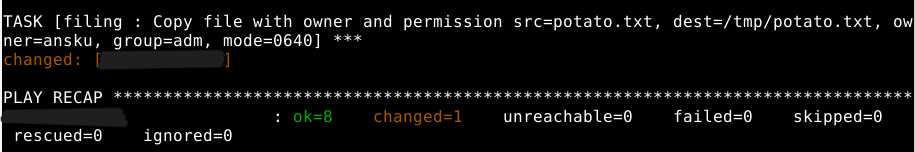

Ainakaan ansible ei antanut mitään virheilmoituksia. Tarkistetaan vielä virtuaalipalvelimen puolelta, että tiedosto on siellä missä pitää, oikealla sisällöllä ja oikeilla oikeuksilla.

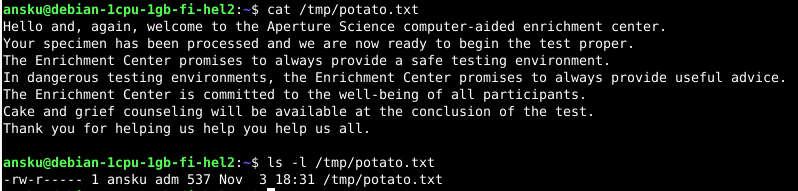

Toimii.

*Oikeuksista:* mode-kohdan '0640' on ensinnäkin kirjoitettu yksinkertaisiin lainausmerkkeihin, jotta YAML tulkitsee sen merkkijonoksi eikä lue pelkkää numerosarjaa yllättävin seurauksin. Aloittava nolla varmistaa, että numerosarja tulkitaan oktaaliksi.

Oktaalimuodossa olevia oikeuksia on kolmea erilaista, lue (read=r), kirjoita (write=w) ja suorita (execute=x). Lukuoikeus sallii pääsyn tiedoston sisältöön, ja myös tiedoston kopioimisen. Kirjoitusoikeus sallii muokata tai muuttaa tiedoston sisältöä. Suoritusoikeus sallii esim. tiedoston koodin tai käskyjen ajamisen.

Kirjainlyhenteiden lisäksi käyttöoikeuksilla on numeerinen arvo: r=4, w=2, x=1. mode-kohdassa aloittavan nollan jälkeen ensimmäinen numero viittaa tiedoston omistajan oikeuksiin, toinen ryhmän oikeuksiin, ja kolmas numero muiden käyttäjien oikeuksiin. Omistajalla, ryhmällä ja muilla on kaikilla kolme oikeutta (rwx), ja useampia oikeuksia annettaessa niiden numeeriset arvot lasketaan yhteen. Oikeudeton tila on arvoltaan 0.  Esim. tämän tehtävän omistajalla on luku- ja kirjoitusoikeudet, muttei suoritusoikeuksia, eli lasketaan 4+2+0=6. Ryhmään 'adm' kuuluvat käyttäjät voivat lukea tiedoston, joten 4+0+0=4 ja muilla ei ole mitään oikeuksia = 0.

Symbolisesti ilmaisuna oikeudet 640 olisivat rw-r----- (Red Hat, 2023)

#### e) Jotain muuta ####

Viimeisessä tehtävässä piti näyttää jokin ansiblen käsky/moduuli, jota ei oltu vielä käsitelty läksyissä tai tunnilla. En muistanut yhtään mitä tunnilla mahdollisesti oli käsitelty, ja service oli näemmä tulossa seuraavalla viikolla.

Valitsin ansiblen omasta dokumentaatiosta moduulin *ansible.builtin.stat*. Sen tarkoituksena on hakea tiedoston tai tiedostojärjestelmän tilatieto. (Ansible, s.a.)

Loin ansiblen roles-kansioon uuden alikansion ja sinne main.yml-tiedoston. 

    mkdir -p roles/stat/tasks/
    nano roles/stat/tasks/main.yml

    - name: Get stats of a file
      ansible.builtin.stat:
        path: /tmp/potato.txt
      register: st
    - name: Fail if the file does not belong to 'ansku'
      ansible.builtin.fail:
        msg: "Bummer. Not your file."
      when: st.stat.pw_name !='ansku'

Lisäsin vielä roolin site.yml-tiedostoon ennen playbookin ajamista.

Dokumentaation esimerkeissä oli kuvattu virheilmoituksen tekeminen, joten halusin kokeilla myös sitä. Siksi pistin ansiblen tarkoituksella tarkistamaan ensin tiedoston, jonka tiesin olevan oikealla omistajalla. 

Tuloksena ansible skippasi tämän vaiheen. Lisäsin varmuuden vuoksi vielä debug-rivin main.yml-tiedostoon (sain tämän ehdotuksen Claudelta, kun en ollut varma, oliko 'skip' oikea lopputulos):

    - name: Get stats of a file
      ansible.builtin.stat:
        path: /tmp/potato.txt
      register: st
    - name: Show the file owner
      ansible.builtin.debug:
        var: st.stat.pw_name
    - name: Fail if the file does not belong to 'ansku'
      ansible.builtin.fail:
        msg: "Bummer. Not your file."
      when: st.stat.pw_name !='ansku'

Ajoin playbookin uudestaan ja varmuuden vuoksi vielä vaiheet selittävällä komennolla (v = verbose)

    ansible-playbook site.yml -v

Tulos oli edelleen 'skipping'. Debug-rivin ansiosta voin olla varma, että ansible hyppää tehtävän yli koska tiedoston omistajan ei kuulukaan aiheuttaa virheilmoitusta.

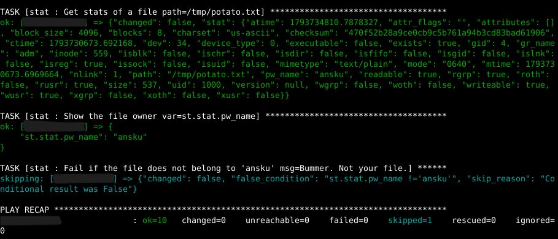

Sen jälkeen muokkasin main.yml-tiedoston virheparametria tarkistamaan olematonta käyttäjää, jotta saan aiheutettua virheilmoituksen. Ensimmäisellä yrityksellä muokkasin käyttäjän riville 'name: Fail if...', mutta unohdin vaihtaa sen riville 'when:'. Kun molemmissa kohdissa oli sama (tietoisesti väärä) nimi, sain odotetun virheilmoituksen:

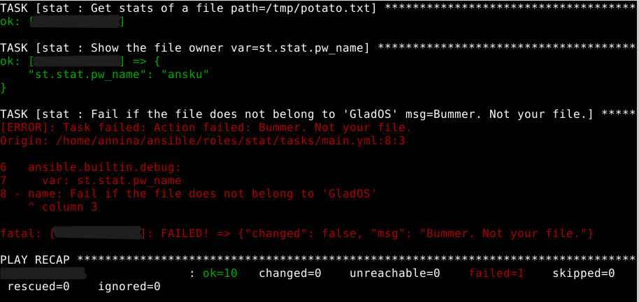

### Lähteet ###

Ansible s.a. Sisäänrakennettu dokumentaatio. Saatavilla: ansible-doc. Luettu: 2.11.2026

Ansible Community Documentation s.a. Saatavilla: https://docs.ansible.com/projects/ansible/latest/collections/ansible/builtin/apt_module.html. Luettu: 3.11.2026.

Karvinen 2026. Passwordless Sudo with Ansible. Saatavilla: https://terokarvinen.com/passwordless-sudo-with-ansible/. Luettu: 2.11.2026

Karvinen 2026. Sudo without password. Saatavilla: https://terokarvinen.com/passwordless-sudo/. Luettu: 2.11.2026

Niemi 2025: H4 Tehtävät. Luettavissa: https://github.com/AONCODES/linux-course/blob/main/h4.md. Luettu 2.11.2026

Munroe 2006. xkdc: Sandwich. Saatavilla: https://xkcd.com/149/. Luettu: 2.11.2026

Red Hat 2023. Linux file permissions explained. Saatavilla: https://www.redhat.com/en/blog/linux-file-permissions-explained. Luettu: 3.11.2026
