## h3 Demoni ##

#### x) Lue ja tiivistä ####

**Apache installed with Ansible - quick notes**

Artikkelissa on kerrottu lyhyesti, miten asennetaan web-palvelin manuaalisesti. Artikkelissa on käytetty Apachea, mutta huomioita voi soveltaa muihinkin demoneihin.

Artikkelissa on esitelty handlers-toiminto, joka voidaan asettaa ajaa komentoja vain silloin, jos koneeseen tehdään muutoksia. (Karvinen 2026)

Oma huomio: tunnilla asennettiin manuaalisesti caddy, se pitää muistaa sammuttaa tai apache ei toimi (käyttävät samaa porttia).

**Handlers: running operations on change**

Ansiblen sisäänrakennettu aputoiminto, jolla ajetaan komentoja vain, jos on tehty muutoksia koneeseen ja muutosten yhteydessä käsketään aputoimintoa suorittamaan itsensä.

Handleria käsketään lisäämällä tasks-tiedostoon komento *notify* ja joko listaamalla yhden tai useamman handlerin ajettavaksi erillisestä tiedostosta, tai handlerit voi myös sisällyttää suoraan tasksiin. Handlerit suoritetaan siinä järjestyksessä, missä ne on handlers-tiedostossa, ei notify-listassa. (Ansible Community Documentation, s.a.)

Oma huomio: Onko järkevämpää pitää handlersit omassa tiedostossaan kuin lisätä tasks-tiedostoon?

**'ansible-doc service'**

Käytetään hallinnoimaan etäkoneen palveluita (services).

- *enabled:* määrittää, käynnistetäänkö palvelu käynnistyksen yhteydessä vai ei
- *name:* palvelun nimi
- *state:* määrittää palvelun tilan
- esimerkki: Käynnistää httpd-palvelun, mikäli se ei ole jo käynnissä

    - name: Start service httpd, if not started
  ansible.builtin.service:
    name: httpd
    state: started

(Ansible, s.a.)

#### a) Apassi ####

Tehtävässä piti asentaa Apache2 käsin, siten että web-sivu näkyy palvelimen etusivulla ja on tavallisen käyttäjän muokattavissa ilman root- tai sudo-oikeuksia.

Olin asentanut virtuaalipalvelimelle Apache2:n jo [h0-vaiheessa](/h0.md), mutta en ollut tehnyt asennusdokumentointia kovin yksityiskohtaisesti, joten päätin poistaa apache2:n sieltä ja asentaa sen uudelleen, jotta saan samalla itselleni paremmat muistiinpanot.

    sudo apt purge apache2
    sudo apt autoremove

Sain jo ensimmäisen komennon aikana varoituksen:

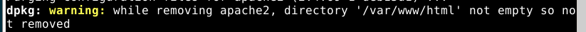

Olin [h0-tehtävän](/h0.md) aikana muokannut index.html-tiedostoa, joten purge-komento ei suostunut poistamaan sitä. Poistin ensin tiedoston ja sitten kansion. Rmdir ei suostu poistamaan kansiota, mikäli se ei ole tyhjä, joten tämä on turvallisempi tapa kuin koko kansion poistaminen komennolla rm -r.

    sudo rm /var/www/html/index.html
    sudo rmdir /var/www/html

Tämän jälkeen asentamisen voi aloittaa alusta.

    sudo apt-get install apache2
    sudo systemctl is-enabled apache2

Tarkistin jälkimmäisellä komennolla, käynnistyykö apache2 Debianin käynnistyessä. Komento tulosti *enabled*, eli käynnistyy.

Olin asentanut jo [h0-tehtävän](/h0.md) yhteydessä palomuurin (ufw) ja avannut portin 80, mutta tarkistin statuksen vielä uudelleen:

    sudo ufw status

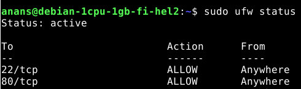

Mikäli portti olisi ollut jostain syystä kiinni, sen olisi saanut avattua:

    sudo ufw allow 80/tcp

Tarkistin vielä, että apache2 toimii ylipäätään.

    curl localhost

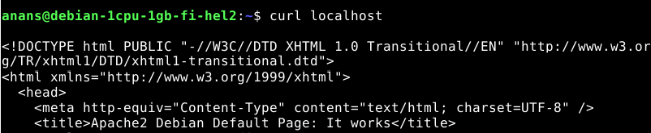

Komennolla tulee tekstiä, mitä kuuluukin olla apache2:n oletussivulla. Olennaisin kohta: "Apache2 Debian Default Page: It works". Verkkoselaimella sivu näkyisi vielä selvemmin, mutta tämä riittää. (Heinonen 2025)

Koska tehtävänannon vinkkien perusteella päättelin, että peruskonfiguraatioiden ja oletuskansioiden kanssa pelaaminen ei riitä, joten aloitin luomalla uuden kansion, jonne teen uuden index-sivun.

    mkdir -p /home/anans/publicwww/
    cd publicwww/
    nano index.html

Huom! Tässä ei käytetä sudo-komentoa. Juuri luodun index.html-tiedoston oikeudet ovat seuraavat:

    -rw-rw-r-- 1 anans anans 17 Nov  9 18:17 index.html

Apache2 pyörii käyttäjänä www-data (kuuluu käyttäjiin other), joten tiedoston ja kansion oikeuksia pitää muokata.

    chmod ugo+x /home/anans/
    chmod ugo+x /home/anans/publicwww/
    chmod ugo+r /home/anans/publicwww/index.html

Komento ugo+x antaa kaikille käyttäjille (owner, group, others) suoritusoikeudet kansioihin. Se on välttämätöntä, jotta apachen www-data pääsee kansioihin. Komento ugo+r antaa kaikille käyttäjille lukuoikeuden index.html-tiedostoon, jotta www-data pääsee lukemaan tiedoston sisällön eli näyttämään sen etusivulla. (Karvinen 2026)

Tarkistetaan vielä oikeuksien tilat komennoilla:

    ls -ld /home/anans /home/anans/publicwww
    stat /home/anans/publicwww/index.html

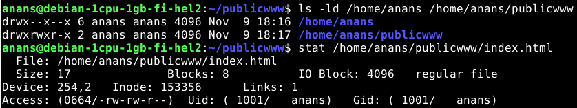

Apache2 lataa edelleen oletussivun, joten uudelle kansiolle ja index.html-tiedostolle pitää tehdä konfigurointitiedosto (luomiseen on käytettävä sudoa).

    sudoedit /etc/apache2/sites-available/example.com.conf

Example.com ei ole paras vaihtoehto pysyväksi osoitteeksi, mutta tässä vaiheessa se helpottaa hahmottamista. (Karvinen 2026)

    <VirtualHost *:80>
        ServerName example.com
        DocumentRoot /home/anans/publicwww/

        <Directory /home/anans/publicwww/>
                require all granted
        </Directory>
    </VirtualHost>

Apachen oletussivu pitää vielä ottaa alas (disable) ja nostaa oma sivuni ylös (enable). Koska en ole muokannut etc/hosts -kansiota ja asettanut ServerName-kohtaa osoittamaan oikein, apache lataa sivut sites-enabled-kansion konfigurointitiedostojen mukaan aakkosjärjestyksessä, jolloin 000-default latautuisi ennen example.comia. (Heinonen 2025)

    sudo a2ensite example.com
    sudo a2dissite 000-default
    sudo apache2ctl configtest

Viimeinen komento tarkistaa vielä, että syntaksi on ok.

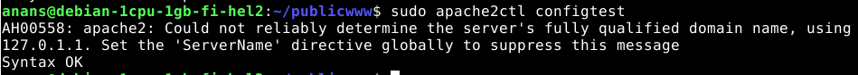

Tuloste herjaa odotetusti domain-nimestä, mutta muuten ok. Muutokset eivät tule käyttöön ennen kuin apachen käynnistää uudestaan, demoni herjasi siitä jo komentojen a2ensite ja a2dissite yhteydessä.

    sudo systemctl reload apache2
    curl localhost

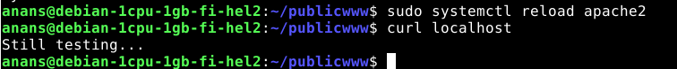

Sisältö toimii. Testataan vielä, että tiedostoa saa muokattua ilman sudoa:

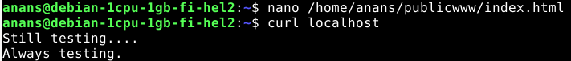

#### b) Moottorix ####

Tehtävässä piti asentaa Nginx käsin, siten että web-sivu näkyy palvelimen etusivulla ja on tavallisen käyttäjän muokattavissa ilman root- tai sudo-oikeuksia.

Koska ngix käyttää myös porttia 80, sammutin apache2:n. Komento pysäyttää sen välittömästi eikä apache myöskään mene päälle käynnistyksen yhteydessä (stop pysäyttää sen vain seuraavaan käynnistykseen asti).

    sudo systemctl disable --now apache2

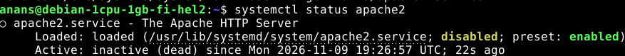

Paketin asennus tapahtuu samalla logiikalla kuin apache2:

    sudo apt-get install nginx
    sudo systemctl status nginx

Paketti asentui ja nginx on toiminnassa. Seuraavat askeleet olisivat samanlaiset kuin apachen kanssa, mutta otan sen verran oikopolkua että en lähde luomaan uutta kansiota ja index.html-tiedostoa oikeuksien muutoksineen, vaan hyödynnän olemassa olevaa rakennetta.

Lisään nginx:lle konfigurointitiedoston ja muokkaan index.html-tiedostoa. Jos kaikki menee hyvin, curl localhost pitäisi näyttää muokattu index.html. Sama tiedosto näkyy sitten vastaavasti, mikäli pudotan nginx:n alas ja käynnistän apache2:n.

Koska kansiorakenne on minulla jo olemassa, seuraavaksi pitää tehdä sivuston konfigurointitiedosto, vastaava kuin apachen /etc/apache2/sites-available/example.com.conf. Nginx:llä oli olemassa default-tiedosto, katsoin mallia siitä:

    nano /etc/nginx/sites-available/default

Rakenne on vähän erilainen kuin apachessa, mutta tiedoston lopussa on annettu suoraan malli example.comille.

    sudoedit /etc/nginx/sites-available/example.com

    server {
       listen 80;
       listen [::]:80;

       server_name example.com;

       root /home/anans/publicwww;
       index index.html;

       location / {
               try_files $uri $uri/ =404;
       }
    }

Eli nyt nginx käyttää aiemmin apachea varten luomaani kansio- ja tiedostorakennetta. Vielä pitää laittaa symlink kansioon /sites-enabled. Hetki meni ymmärtää, mitä tarkoitti symlink to site-enabled/. Kysyin tämän kohdan Claude Sonnet 5.5 -tekoälyltä. 

Ensin poistetaan linkki asennuksen yhteydessä automaattisesti syntyvään defaultiin, ja sitten lisätään linkki luomaani example.comiin:

    sudo rm /etc/nginx/sites-enabled/default
    sudo ln -s /etc/nginx/sites-available/example.com /etc/nginx/sites-enabled/example.com

Jos tätä default-linkkiä ei poista, niin *curl localhost* näyttää vain /sites-available/default sisällön. Tämä ei olisi ongelma, jos olisin muokannut suoraan default-tiedostoa.

Nyt sites-enabled-kansiossa on defaultiin osoittavan linkin sijaan enää linkki luomaani example.comiin:

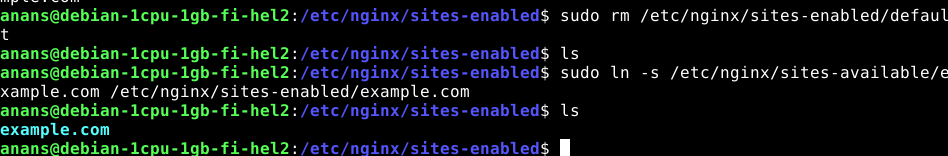

Testataan vielä syntaksi kuten apachessa (Karvinen 2026).

    sudo nginx -t

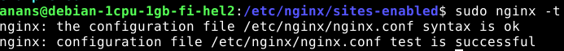

Sitten vielä demonin uudellenkäynnistys, että asetukset tulevat voimaan, ja localhostina pitäisi näkyä sama sisältö kuin apachella.

    sudo systemctl reload nginx
    curl localhost

Näkyyhän se. Vielä muokkaus ilman sudoa ja uudelleen curl, lopputuloksena näkyy muokattu index.html.

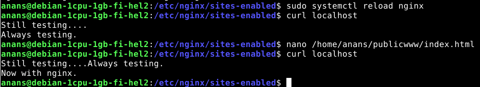

#### c) Automoottorix ####

Tässä tehtävässä piti automatisoida nginx:n asennus ansiblen avulla.

Jotta nginx asentuu virtuaalipalvelimelle, se pitää ensin poistaa sieltä. Päätin kuitenkin tehdä ensin isäntäkoneelle ansiblen kansiot ja tiedostot ennen kuin isken orjakoneelle purgen.

Aloitin luomalla ansibleen (cd ansible/) nginx:lle kansiorakenteen mukaillen apachen asennusohjeita (Karvinen 2026).

    mkdir -p roles/nginx/files/ roles/nginx/handlers/ roles/nginx/tasks/
    nano roles/nginx/files/example.com

Files-kansioon tulee example.comin konfugurointitiedosto, joten loin sinne saman tiedoston samalla sisällöllä kuin äsken manuaalisesti virtuaalipalvelimelle.

    nano roles/nginx/handlers/main.yml
    cat roles/nginx/handlers/main.yml

    - name: restart nginx
      systemd:
        name: nginx
        state: restarted

Em. sijaintiin tuleva sisältö käynnistää nginx:n uudelleen. Vaatii notify-rivin tiedostoon /tasks/main.yml. Mukailtu Karvisen apache-mallista. (Karvinen 2026)

**HOX! Karvisen malli on pielessä, rivi *systemd:* pitää olla *service:*, muuten aiheuttaa virheen. Huomasin vasta ajon jälkeen**

Tämän jälkeen loin main.yml-tiedoston tasks-kansioon. Käytin pohjana Karvisen apache-mallia (id.), mutta läksyjen vinkeissä oli mainittu ansible-doc: state ja update_cache, joten lisäsin ne ansiblen dokumentaation esimerkkien perusteella (Ansible Community Documentation).

    nano roles/nginx/tasks/main.yml
    cat roles/nginx/tasks/main.yml

    - name: Install nginx
    apt:
        name: nginx
        state: present
        update_cache: yes
        cache_valid_time: 3600

    - name: Copy nginx site config
    copy:
        dest: "/etc/nginx/sites-available/example.com"
        src: "example.com"
        owner: "root"
        group: "root"
        mode: "0644"
    notify: restart nginx

    - name: Create symlink for example.com
    file:
        src: /etc/nginx/sites-available/example.com
        dest: /etc/nginx/sites-enabled/example.com
        owner: root
        group: root
        state: link
    notify: restart nginx

Tämän jälkeen lisäsin vielä nginx tiedoston site.yml roles-listaan. Ennen playbookin ajamista piti vielä poistaa nginx virtuaalipalvelimelta.

    sudo systemctl disable --now nginx
    sudo apt purge nginx
    sudo apt autoremove

Tarkistin vielä ls /etc/nginx, jossa oli jäljellä tiedostoja (olin tehnyt muutoksia sites-kansioihin, joten ei yllättänyt, etteivät ne poistuneet). Poistin kansion.

    sudo rm -r /etc/nginx
    ls /etc/nginx

Nyt on tyhjää. Testasin vielä site.yml-tiedoston syntaksin:

    ansible-playbook site.yml --syntax-check

Ei tullut virheitä, joten yml pitäisi olla ok.

    ansible-playbook site.yml

Komennon ajaminen meni alkuun ok, mutta handler-kohta aiheutti virheen.

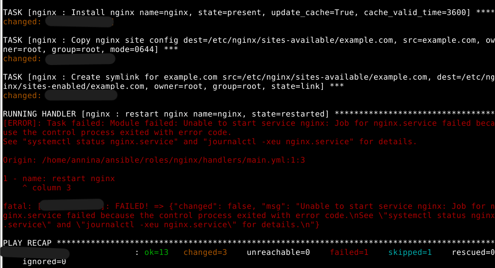

Tarkistin ansiblen omasta dokumentaatiosta oikean sanamuodon, pitää olla service eikä systemd (Ansible Community Documentation):

    nano roles/nginx/handlers/main.yml
    cat roles/nginx/handlers/main.yml

      - name: restart nginx
      service:
        name: nginx
        state: restarted

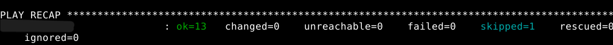

Tarkistetaan vielä, että localhost toimii.

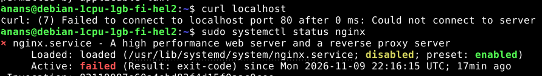

Ei toiminut, jostain syystä nginx ei lähde käyntiin. Onneksi virheilmoitus antaa vinkkejä, mistä alkaa etsiä virheen syytä. Ehdotettu komento ei ollut minulle tuttu, mutta löysin selityksen netistä (Panovski, 2026) ja komennon omalta man-sivulta.

    sudo journalctl -xeu nginx --no-pager | tail -n 30

-x lisää selitykset kun mahdollista, -e hyppää sivun loppuun ja -u rajaa lokit tiettyyn ohjelmaan (lisää sen nimi, kuten tässä nginx). No-pager poistaa tulosten sivutuksen.

Koska virhe oli todennäköisesti lokin loppupäässä, lisäsin vielä erikseen tail-komennon. 

Tästä tulosteesta löytyy kohta:

[emerg] 76255#76255: open() "/etc/nginx/nginx.conf" failed (2: No such file or directory)

Eli aiemmin tekemäni 'purge' ja manuaalinen /etc/nginx tyhjentäminen meni pieleen, koska 'nginx.conf-tiedoston' olisi pitänyt asentua playbookin ajamisen yhteydessä.

Kokeillaan vielä puhdistaa nginx kertaalleen, oikea komento olisikin 

    sudo apt purge nginx nginx-common 
    
Ilman nginx-common attribuuttia osa tiedostoista jää näköjään jälkeen ja aiheuttaa saamani virheen. Olin lisännyt komentoon perään artikkelin perusteella myös ngingx-core, mutta Debian ilmoitti, ettei sitä ole asennettu joten sitä ei myöskään poisteta. (Gite 2025)

Ajoin vielä lisäksi 

    sudo apt autoremove 
    
ja tarkistin että paketteja tai kansiota ei ole jäljellä

    dpkg -l nginx nginx-common
    ls /etc/ngingx

Ei löydy tiedostoja viimeisen purgen jäljiltä.

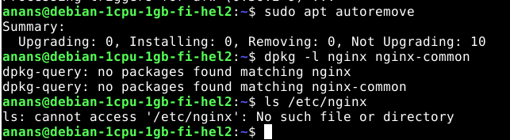

Playbook meni myös läpi ilman ongelmia.

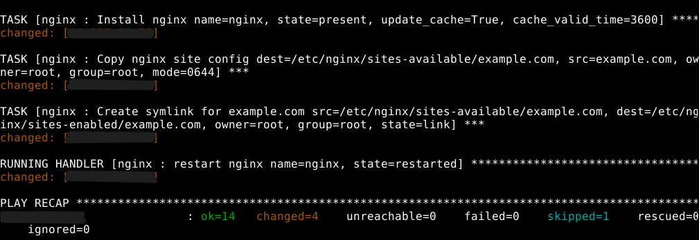

Ja sudo systemctl status nginx näyttää että nyt se on käynnissä, kuten pitääkin.

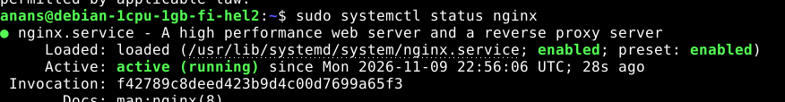

Mutta curl localhost ei vieläkään toimi halutulla tavalla, oman sivun sijaan tulostuu 
Apache2:n oletussivu.

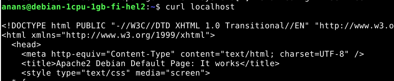

Hetken aikaa omia muistiinpanojani kerrattua tajusin, että luomani playbook asentaa nginx-paketin perusasetuksilla. Se tarkoittaa siis sitä, että manuaalisessa asennuksessa poistamani default-tiedostot ovat nyt taas olemassa, ja ajavat example.comin ohi. Sites-enabled-kansion symlink pitää poistaa myös automatisoidussa asennuksessa.

Löysin ansiblen ohjeistuksesta esimerkin, että file-toiminnolla voi myös poistaa linkin. En ollut ihan varma, onko sillä väliä laittaako sen ennen vai jälkeen symlinkin luomisen, mutta laitoin sen varmuuden vuoksi järjestyksessä ensimmäiseksi. 

Lisäsin myös nimet toiminnoille, vaikka sitä kritisoitiinkin luennolla ilmeisen tarpeettomaksi, mutta tässä vaiheessa opiskelua se selventää minulle paljon nopeammin, että missä mennään.

    nano /roles/nginx/tasks/main.yml
    cat /roles/nginx/tasks/main.yml

    - name: Install nginx
      apt:
        name: nginx
        state: present
        update_cache: yes
        cache_valid_time: 3600

    - name: Copy nginx site config
      copy:
        dest: "/etc/nginx/sites-available/example.com"
        src: "example.com"
        owner: "root"
        group: "root"
        mode: "0644"
    notify: restart nginx

    - name: Remove symbolic link for nxing default page
    file:
        path: /etc/nginx/sites-enabled/default
        state: absent
    notify: restart nginx

    - name: Create symlink for example.com
    file:
        src: /etc/nginx/sites-available/example.com
        dest: /etc/nginx/sites-enabled/example.com
        owner: root
        group: root
        state: link
    notify: restart nginx

Nyt jos kaikki menee kuten pitääkin, niin playbook menee läpi ilman ongelmia, ja sen jälkeen curl localhost näyttää muokatun etusivun.

Ainakin asennus onnistui kuten pitikin.

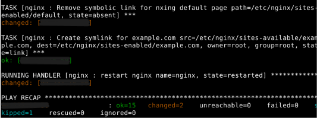

Myös *curl localhost* menee nyt oikein.

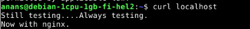

Sivua pystyy myös muokkaamaan virtuaalipalvelimelle kirjautuneena käyttäjänä ilman sudo-oikeuksia.

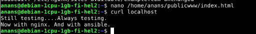

Huom! Muokkaus toimii siksi, että index.html-tiedoston ja siihen liittyvien kansioiden pääsyoikeudet olivat etukäteen kunnossa virtuaalipalvelimellani. Jos ajaisin ansiblen puhtaalle koneelle, minun pitäisi huomioida oikeuksien määrittely eri tavalla ansiblessa.

#### d) Vapaaehtoinen bonus ####

Skipattu ainakin toistaiseksi.

### Lähteet ###

*Huom. ristiinarvioijalle tiedoksi, koska tämä tuntuu aiheuttavan usein epäselvyyttä. Virallisen lähdeviiteohjeistuksen mukaan "Tekoälyn tuottamaan tekstiin ei tehdä tekstiviitettä eikä sitä merkitä lähdeluetteloon [...] Kuvaa sopivassa kohdassa ja tarkoituksenmukaisella laajuudella, mitä työkalua olet hyödyntänyt ja miten."*

Ansible s.a. Sisäänrakennettu dokumentaatio: 'ansible-doc service'. Saatavilla: terminaalikomennolla ansible-doc service. Luettu: 9.11.2026

Ansible Community Documentation, s.a. Handlers: running operations on change. Saataville: https://docs.ansible.com/projects/ansible/latest/playbook_guide/playbooks_handlers.html. Luettu: 9.11.2026

Gite 2025. How to uninstall Nginx on Ubuntu / Debian Linux. Saatavilla: https://www.cyberciti.biz/faq/remove-uninstall-nginx-from-ubuntu-debian-linux-apt-get-command/. Luettu 10.11.2026

Heinonen, 2025. Apache2. Saatavilla: https://github.com/johannaheinonen/johanna-test-repo/blob/main/module_3.md. Luettu: 9.11.2026

Karvinen, 2026. Apache installed with Ansible - quick notes. Saatavilla: https://terokarvinen.com/apache-ansible/. Luettu: 9.11.2026

Panovski, 2026. journalctl Command in Linux: Query and Filter System Logs. Saatavilla: https://linuxize.com/post/journalctl-command-in-linux/. Luettu: 10.11.2026