## h4 Pizza Fantasia ##

#### x) Lue ja tiivistä ####

**Configuration Management of Distributed Systems over Unreliable and Hostile Networks**

4.12.1 Size and Complexity of Some DSLs

Konfigurointien hallintatyökalujen käyttämä kieli voi kasvaa laajaksi ja monimutkaiseksi. Esimerkkinä oli tutkittu Saltia ja Puppetia, joissa oli molemmissa yli sata erilaista funktiota hallittavien resurssien kontrollointiin. Lisäksi näiden funktioiden käyttö, erityisesti valmiissa malleissa, hyödyntää vielä erillistä koodirakennetta, mikä lisää hallittavien kielirakenteiden määrää entisestään.

4.12.2 Use of DSL Functions in Case Configuration

Tutkimuksessa todettiin, että vaikka hallintatyökalut tarjoavat laajan määrän funktioita järjestelmän hallintaan, viime kädessä vain kourallinen riittää kattamaan yleisimmät tarpeet.

4.12.3.1 Dependencies Between Main Functions

Koska järjestelmä voidaan konfiguroida pienellä määrällä komentoja, on järkevää rakentaa sen tila yksinkertaiseksi ja idempotentiksi. Järjestelmän ajaminen tekee kontrolloitaviin resursseihin muutoksia vain siinä tapauksessa, että niissä on jotain muutettavaa. (Karvinen, 2023)

#### a) Räpylä ####

Tehtävässä piti asentaa omavalintainen daemoni manuaalisesti. Päädyin lopulta kokeilemaan mariadb-tietokantahallintaohjelman asentamista.

Tarkistin ensin, ettei se ollut jo asennettu virtuaalipalvelimelleni (ei pitäisi olla, mutta laitan tässä samalla itselleni komennot muistiin):

    dpkg -l mariadb-server
    apt policy mariadb-server

Odotetusti, molemmat näyttivät negatiivista. Kumpi tahansa olisi siis riittänyt yksinäänkin. Huom! Paketti kulkee nimellä mariadb-server ja ohjelma nimellä mariadb.

Ajetaan vielä pakettilistan päivitys ja asennetaan MariaDB:

    sudo apt update
    sudo apt install mariadb-server

MariaDB:n asennusohje (MariaDB, s.a.) ehdottaa myös lisäämään galera-4 ja mariadb-client, mutta edellä olevalla komennolla ne asentuvat joka tapauksessa, ellei erikseen kiellä.

Kun ajetaan uudelleen alun komennot (dpkg -l ja apt policy) sekä

    command -v mariadb

nähdään että mariadb on asentunut ja minne.

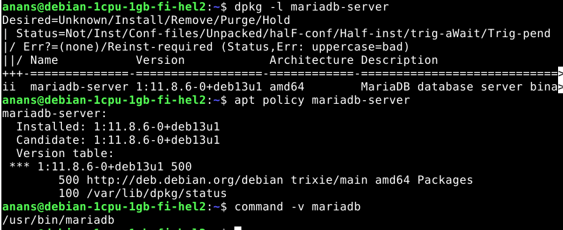

Ajoin lisäksi MariaDB:n sivuilla ehdotetun komennon turvallisemmasta asentamisesta:

    sudo mariadb-secure-installation

Ensimmäiseksi ruutuun tuli teksti, että tämän ajaminen on parhaimmillaan tarpeetonta ja huonoimmillaan harhaanjohtavaa. Valitsin vaihtoehdot unix_socket root-salasanan sijaan, estin etäkirjautumisen rootilta, poistin nimettömät käyttäjät ja testitaulut. Kirjoitan tämän lähinnä muistiin, jotta voin huomioida asian ansible-vaiheessa.

Kokeilin kirjautua sisään mariadb -u anans, mutta en päässyt. Tämä ei sinänsä yllätä, koska palvelimen käyttäjä ei tarkoita että mariadb:llä on kyseistä käyttäjää, se pitää luoda sinne. Tässä vaiheessa kuitenkin tarkoitus on vain näyttää, että mariadb ylipäätään toimii tällä koneella, joten kirjauduin sisään sudona:

    sudo mariadb

Käytin testikannan luomiseen mallitekstejä, jotka löytyvät suoraan MariaDB:n sivuilta (MariaDB, s.a.). Tein ensin tietokannan ja otin sen aktiiviseksi:

    CREATE DATABASE bookstore;
    USE bookstore;

Sitten loin tietokantaan taulukon:

    CREATE TABLE books (
        isbn CHAR(20) PRIMARY KEY,
        title VARCHAR(50),
        author_id INT,
        publisher_id INT,
        year_pub CHAR(4),
        description TEXT
    );

Ja lopulta tulostin sen näkyville terminaaliin:

    DESCRIBE books;

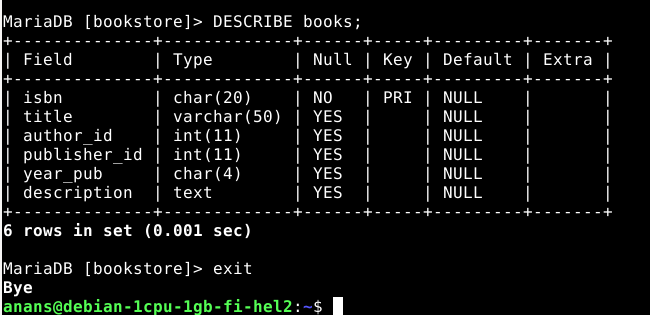

Kuvasta näkee, että olen kirjautuneena MariaDB:n bookstore-nimiseen taulukkoon, exit-komennolla pääsee tietokantaohjelmasta pois.

#### b) Automaatti ####

Tässä tehtävässä piti automatisoida valitsemani daemonin (eli MariaDB:n) asennus ansiblella.

Ensin poistin mariadb:n virtuaalipalvelimelta:

    sudo systemctl disable --now mariadb
    sudo apt purge mariadb-server mariadb-common
    sudo apt autoremove

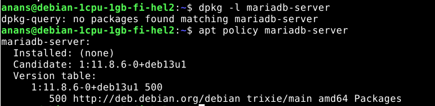

Edellisessä tehtävässäni alussa käyttämäni komennot näyttävät, ettei pakettia enää löydy koneelta.

Tein isäntäkoneen ansible-kansioon uuden kansion ja alikansiot mariadb:lle, sekä aloitin main.yml-tiedoston rakentamista:

    mkdir -p roles/mariadb/tasks roles/mariadb/handlers
    nano roles/mariadb/tasks/main.yml

    - name: Install mariadb
      apt:
        name: mariadb-server
        state: present
        update_cache: yes
        cache_valid_time: 3600

    - name: Ensure mariadb is running and enabled
      service:
        name: mariadb
        state: started
        enabled: yes

En lisännyt ansibleen mitään liittyen komentoon mariadb-secure-installation, koska mariadb ei itsekään varsinaisesti sitä suositellut. Eli asennus eroaa tältä osin manuaalisesta. Main.yml-pohja tehty edellisen viikon [h3](/h3.md)-tehtäväni nginx-mainin perusteella.

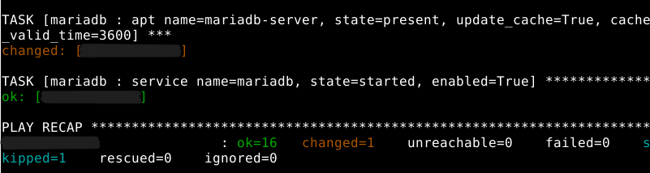

Tämän jälkeen varmistin vielä virtuaalipalvelimen puolelta, että mariadb asentui, käynnistyy ja pääsen sudolla sisään:

    systemctl status mariadb
    systemctl is-enabled mariadb
    sudo mariadb

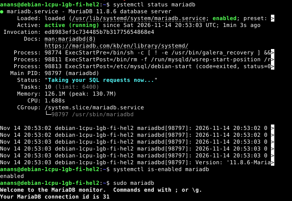

Playbookin ajaminen toisen kerran näyttää, että muutoksia ei tule.

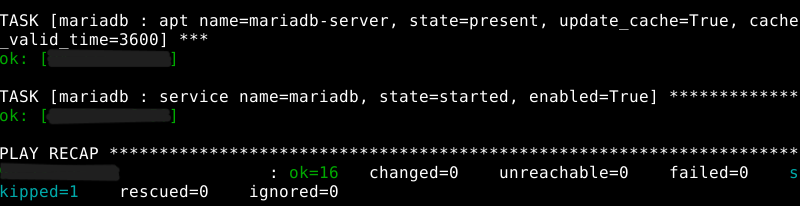

#### c) Asetus ####

Tässä tehtävässä piti muuttaa asetustiedostoa isäntäkoneella, ajaa ansible uudestaan ja osoittaa, että tehdyt muutokset tulivat käyttöön.

Metsästin alkuun mariadb:n konfugurointitiedostoja, jotka löytyivät kansiosta */etc/mysql/*. Varsinainen pää-konfigurointitiedosto löytyy */etc/mysql/mariadb.conf.d/50-server.cnf* (Krenn, 2025). 

Krenn mainitsee arvon *max_connection* (id.). Kyseessä on arvo, joka määrittelee suurimman sallitun määrän yhtäaikaisia yhteyksiä. Konfigurointitiedostossa 50-server.cnf kyseiseen kohtaan on laitettu arvoksi 50, mutta kohta on kommentoituna, eli se ei ole käytössä.

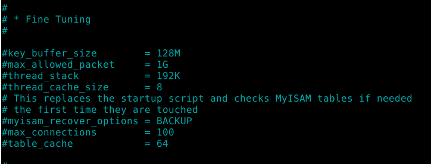

Koska en muista SQL-syntaksia ulkoa, kysyin tekoälyltä (Claude Sonnet 5.5) miten löydän tällä hetkellä voimassa olevan max_connections-arvon. Se löytyi mariadb:n tietokannasta SQL-komennolla:

    SELECT VARIABLE_NAME, GLOBAL_VALUE, DEFAULT_VALUE, GLOBAL_VALUE_ORIGIN, GLOBAL_VALUE_PATH
    FROM information_schema.SYSTEM_VARIABLES
    WHERE VARIABLE_NAME = 'MAX_CONNECTIONS';

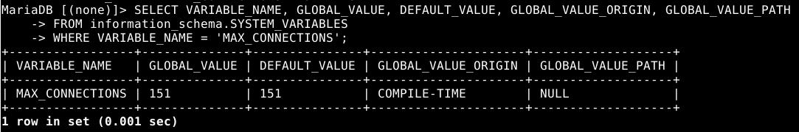

Kuvan taulukosta näkee, että arvo MAX_CONNECTIONS on nyt 151 ja GLOBAL_VALUE_PATH = NULL, eli arvoa ei ole haettu mistään asetustiedostosta, vaan ilmeisesti 151 on mariadb:n oletusarvo.

Tiedosto /etc/mysql/my.cnf kertoo, missä jräjestyksessä mariadb lukee konfigurointitiedostoja, ja viimeisenä luettu jää voimaan.

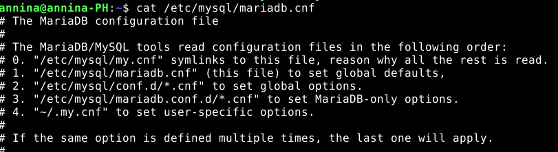

Oma konfigurointitiedostoni pitää laittaa kansioon *etc/mysql/mariadb.conf.d/* ja varmistaa, että se on nimetty niin, että se luetaan aakkosten mukaan viimeisenä tiedostona.

Aloitin nopeammasta, eli tein mariadb:n uudelleenkäynnistävän handlerin.

    nano roles/mariadb/handlers/main.yml

    - name: restart mariadb
    service:
      name: mariadb
      state: restarted

Sen jälkeen lisäsin jo olemassa olevaan roles/mariadb/tasks/main.yml-tiedostoon palikat, joilla lisätään mariadb:n asennuksen yhteydessä uusi konfigurointitiedosto mukaan, ja käynnistetään sen jälkeen mariadb uudelleen, jotta asetukset tulevat voimaan. 

Koska asetustiedostoni on todella pieni (kaksi riviä), kirjoitan sen suoraan ansiblessa sen sijaan, että siirtäisin isäntäkoneellani olevaa valmista tiedostoa orjakoneelle. Kopioin oikeudet muista kohdekansiossa 

    nano roles/mariadb/tasks/main.yml

    - apt:
        name: mariadb-server
        state: present
        update_cache: yes
        cache_valid_time: 3600

    - service:
        name: mariadb
        state: started
        enabled: yes

    - copy:
        content: |
          [mariadb]
          max_connections = 50
        dest: /etc/mysql/mariadb.conf.d/99-custom.cnf
        owner: root
        group: root
        mode: '0644'
      notify: restart mariadb

Tämän jälkeen ajetaan ansible (ansible-playbook site.yml) ja toivotaan parasta.

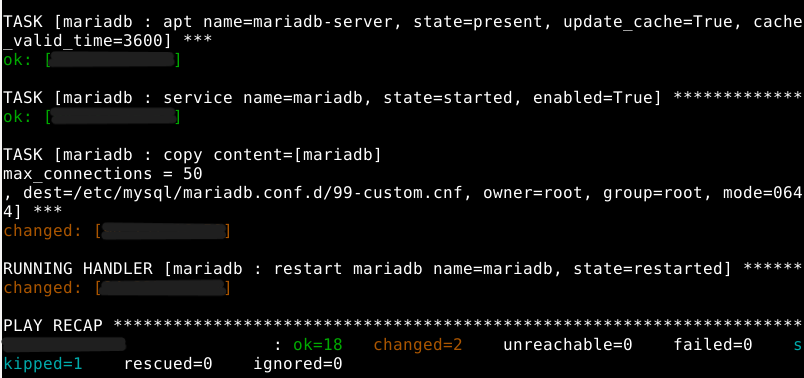

Mariadb oli jo asennettu, joten ainoat muuttuneet arvot olivat konfigurointitiedoston luominen ja handleri, kuten pitikin. Jos asetukset tulivat voimaan, niin max_connections-arvon pitäisi olla 50 ja polku tiedostoon pitäisi olla isäntäkoneella tekemäni konfigurointitiedosto.

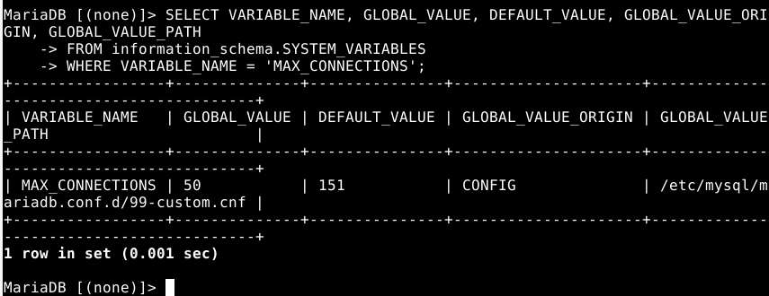

Olihan se. Toisella playbook-ajolla muutoksia 0, kuten pitääkin.

#### d) Paikka remonttiin ####

Tässä tehtävässä piti rikkoa jotain asetuksia, ajaa sen jälkeen ansible uudelleen ja osoittaa, että se korjasi tilanteen.

Koska daemonin poistaminen annettiin vaihtoehdoksi, se on helpoin toteuttaa. Ajan virtuaalipalvelimella samat komennot, kuin mariadb:n manuaalisen poistamisen yhteydessä.

    sudo systemctl disable --now mariadb
    sudo apt purge mariadb-server mariadb-common
    sudo apt autoremove

Ja varmistetaan, ettei mariadb enää löyty virtuaalipalvelimelta:

    dpkg -l mariadb-server
    apt policy mariadb-server

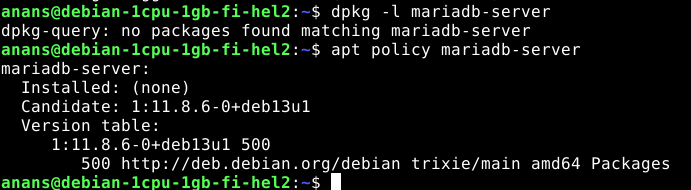

Mariadb on poistettu virtuaalipalvelimelta, mutta poiston yhteydessä sain huomautuksen, että kansio /etc/mysql/mariadb.conf.d/ ei ollut tyhjä, eikä sitä poistettu. Tämä oli odotettavaa, sillä ansible ajoi oman konfigurointitiedostoni tuonne. Sillä ei ole merkitystä tässä vaiheessa, koska sen ei pitäisi estää uutta ansible-ajoa mitenkään.

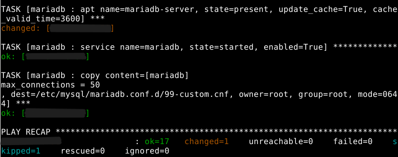

Kuten pitikin, mariadb asentui uudelleen. Konfigurointitiedoston osalta ei tullut muutoksia, kun sitä ei oltu poistettu.

Tietokantakin toimii kuten pitää, ja max_connections on asettamani rajan mukainen. SQL-syntaksissa käytetään yleensä isoja kirjaimia, mutta tein vahingossa kirjoitusvirheen ja näköjään komento menee läpi pienilläkin kirjaimilla (tai sekamuotoisena), kunhan syntaksi on oikein.

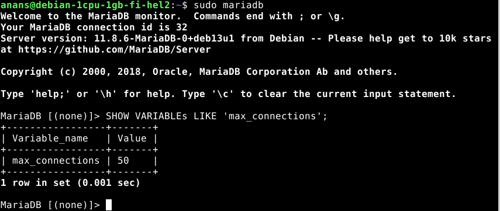

#### e) Idempotentti ####

Tässä tehtävässä piti osoittaa palvelimen tilan olevan idempotentti, eli se ei muutu vaikka sama metodi ajetaan useamman kerran.

Edellisessä tehtävässä ansiblen ajaminen asensi poistuneen mariadb:n uudelleen. Nyt kun ajan komennon

    ansible-playbook site.yml

uudelleen, niin ansiblen lopputuloksena pitäisi olla kaikki ok, ei muutoksia.

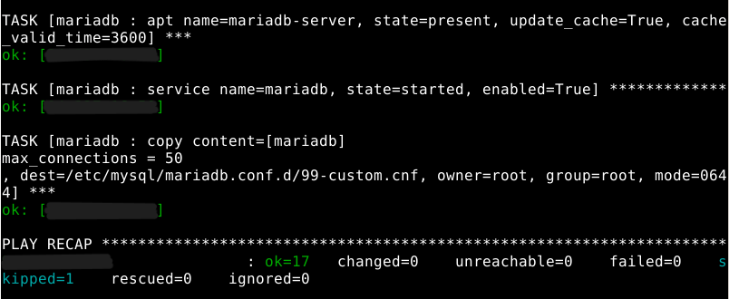

Lisäksi ajamalla virtuaalipalvelimella

    systemctl status mariadb

näkee, että mariadb on ollut käynnissä 12 minuuttia, eli suurin piirtein sen aikaa, kun asensin sen poiston jälkeen uudelleen ja kirjoitin raporttia tähän kohtaan.

**Edit 16.11.2026 klo 21.40:** Lisätty tähän vielä kuva ansiblen tämänhetkisestä kansiorakenteesta.

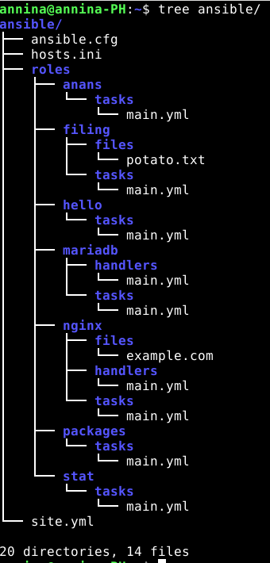

**Edit 17.11.2026:** Vertaisarvioinnin perusteella lisätty b-kohtaan main.yml-konfiguraation lähde ja korjattu koko tiedoston otsikko.

### Lähteet ###

Karvinen 2023: Configuration Management of Distributed Systems over Unreliable and Hostile Networks. Saatavilla: https://westminsterresearch.westminster.ac.uk/item/w7vvz/configuration-management-of-distributed-systems-over-unreliable-and-hostile-networks. Luettu: 14.11.2026

Krenn 2025. Installation and configuration of MariaDB. Saatavilla: https://www.thomas-krenn.com/en/wiki/Installation_and_configuration_of_MariaDB. Luettu: 16.11.2026

MariaDB s.a. Installing MariaDB Server Guide. Saatavilla: https://mariadb.com/docs/server/mariadb-quickstart-guides/installing-mariadb-server-guide. Luettu: 14.11.2026

MariaDB s.a. Basics Guide. Saatavilla: https://mariadb.com/docs/server/mariadb-quickstart-guides/basics-guide. Luettu: 14.11.2026